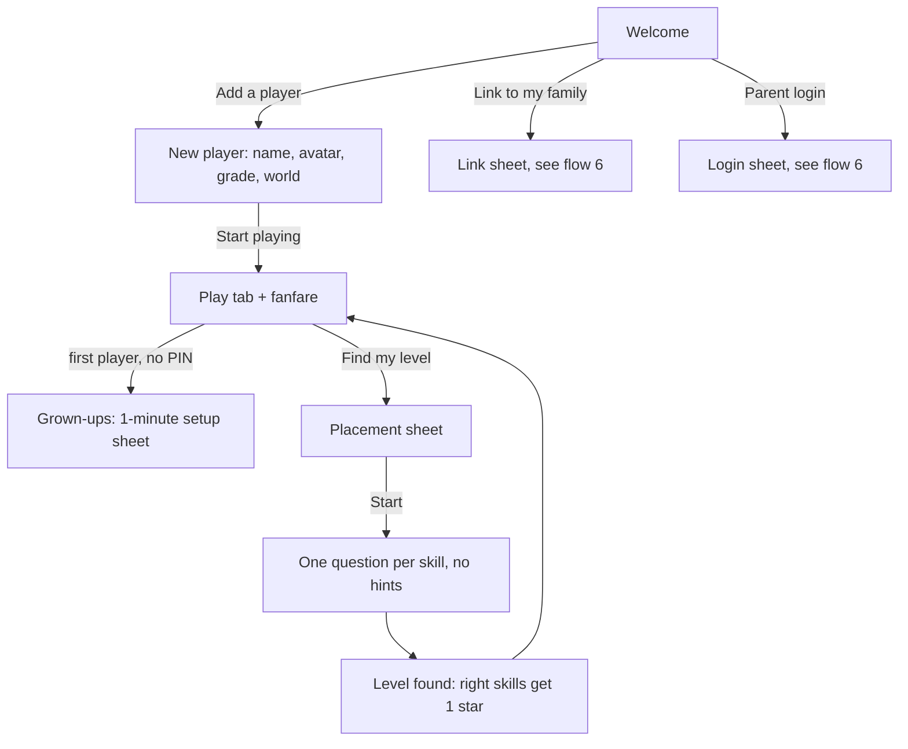
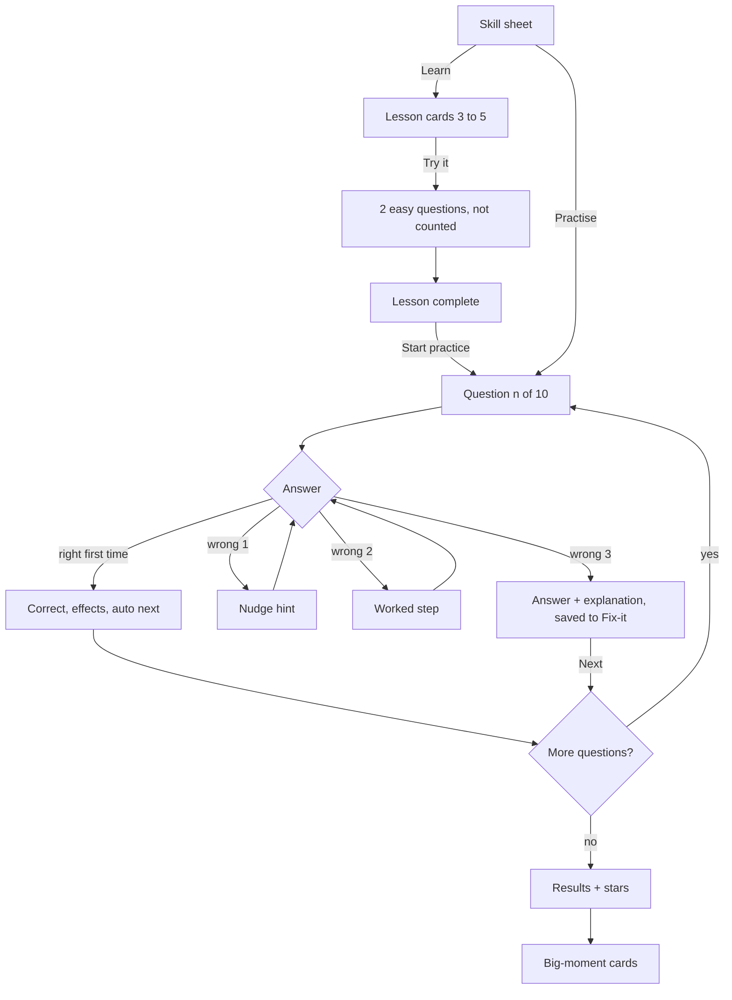
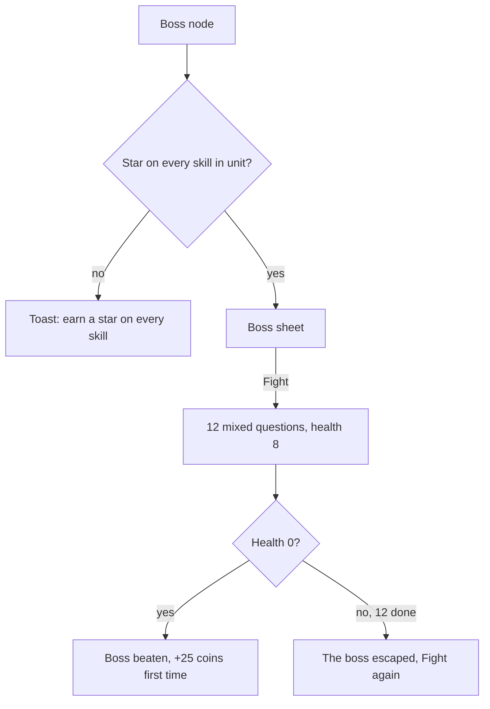
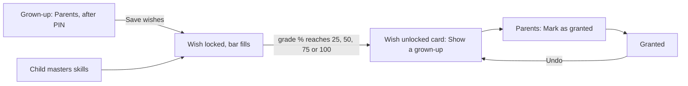
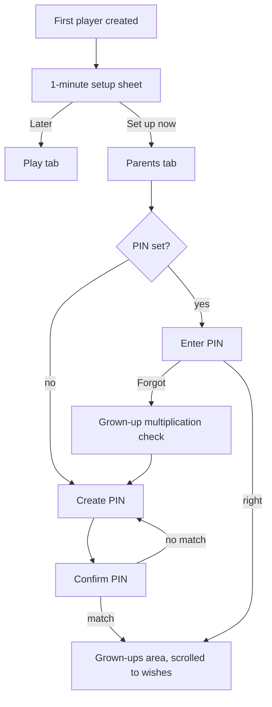
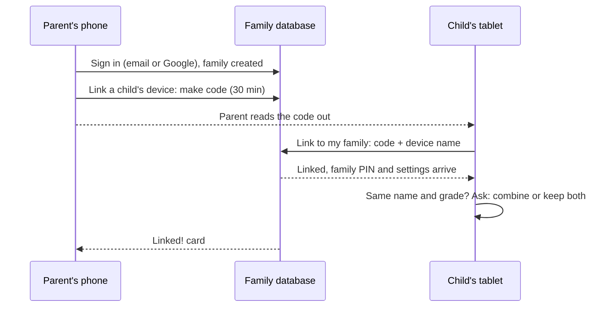
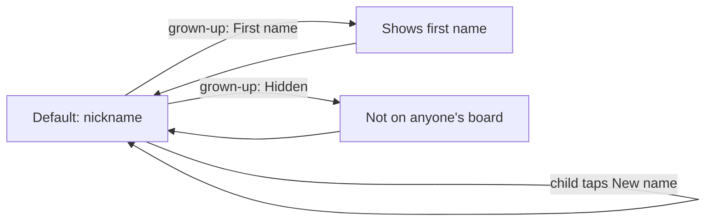
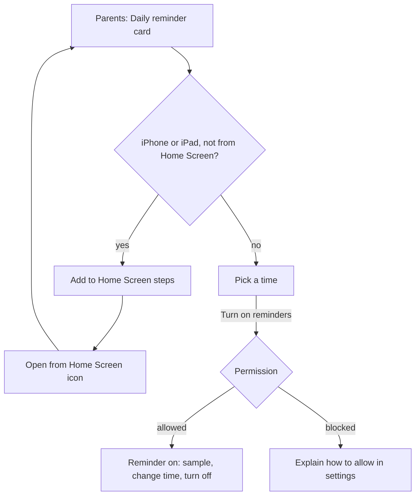
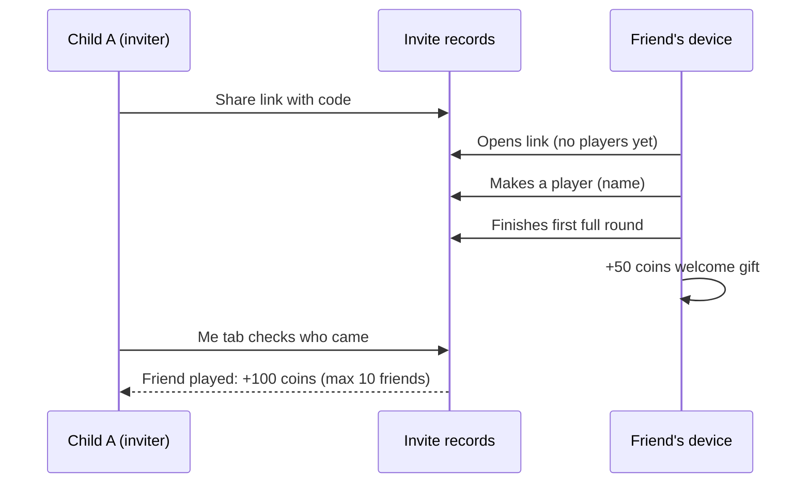

# UX flows

**Who this is for:** designers, testers and partners who want to walk through the main journeys step by step, and developers checking where each step lives in the code.

**Last checked against:** BUILD 2026-10-25 18:32 UTC.

Screens and copy are in `src/engine.js` (functions `render…` and the `ACT` actions). Words in quotes are the real labels on screen. Flowcharts use Mermaid.

**Contents:** [First run and placement](#1-first-run-and-placement) · [Practice round and hint ladder](#2-a-practice-round-and-the-hint-ladder) · [Boss battle](#3-boss-battle) · [Wishes](#4-wishes-set-unlock-grant) · [Grown-up quick start and PIN](#5-grown-up-quick-start-and-pin) · [Parent login and linking](#6-parent-login-and-linking-a-childs-device) · [Leaderboard privacy](#7-leaderboard-privacy-choice) · [Reminders](#8-turning-on-reminders) · [Invite a friend](#9-invite-a-friend)

## The app at a glance

- **Top bar:** player chip (avatar, hat, level), 🔥 streak, 🪙 coins, ☁️ sync status when linked, 🔊 mute.
- **Tabs:** *world emoji* Play · 🎁 Wishes · 🏆 Me · 🏅 Top (when the leaderboard is on) · 🔒 Parents.
- **Full-screen views without tabs:** welcome, new player, lesson, round, results, sticker album.
- **Sheets** slide up for choices and confirmations; **big-moment cards** cover the screen for celebrations.

## 1. First run and placement

1. The welcome screen shows the logo, Blip the robot ("Hi! I'm Blip. Let's make maths fun, one combo at a time!") and one pulsing button: **Add a player**.
   - When online family accounts are set up, two quieter buttons sit below: **🔗 Link to my family** and **👤 Parent login**.
2. **New player:** name (up to 16 characters), one of 8 avatars, grade 1–9 (the Cambridge stage is shown next to it), and a world. The screen re-colours as soon as a world is tapped.
3. **Start playing** makes the player, plays a fanfare with a particle burst, and opens the Play tab.
4. On the first player of a device with no PIN, the grown-up quick start opens after about 1.4 s (see [flow 5](#5-grown-up-quick-start-and-pin)).
5. The Play tab shows: grade picker, today card (pet, week of streak days, rounds left today), the progress ring with the mascot and a suggested next skill, **🔧 Fix-it** and **🧭 Find my level**, the next wish, today's 3 quests and the map.
6. **Placement is optional.** **🧭 Find my level** explains: "One question from every skill in Grade N. No hints this time. Skills you get right earn a star, so you can skip ahead." → **Start**.
7. One question per skill at level 2. A wrong answer shows "The answer is …" and moves on after 1.8 s. No hints, and the music stays plain (no combo layers).
8. Results: "Level found!" and "You already know X of Y skills. They now have a star, so you can jump ahead!"

## 2. A practice round and the hint ladder

1. Tap a skill on the map → the **skill sheet**: stars, level, mastery dots ("Get 8 of your last 10 right first time, on 2 different days"), **📖 Learn** and **▶ Practise**. With 2 stars, **⚡ Extra challenge (60 seconds)** appears too.
2. **Learn** opens 3–5 lesson cards with a picture, 🔊 read aloud, and **◀ Back** / **Next ▶**. The last card is a worked example; the mascot says "Now you try two easy ones. Hints are free!"
3. **Try it! ✏️** gives two level-1 questions that don't count → "Lesson complete!" → **▶ Start practice**.
4. A practice round has **10 questions**. Mixed in: up to one old mistake from this skill, one from another skill (both from Fix-it), and one quick review of an older starred skill.
5. Each question shows the progress dots, the 🔥 combo, brain power, the mascot, the picture, the question and the keypad or choices. **💡 Hint** and **🚩** sit below.
6. The hint ladder:

| Try | Feedback line | Help shown | Mascot says (examples) |
|---|---|---|---|
| Right first time | "Correct! +N 🧠" and a **Why?** link | none | "Nailed it!", "Brain power rising!" |
| 1st wrong | "Not quite. Try again!" | 💡 **Nudge**: a reminder of the method | "Almost! Here is a clue." |
| 2nd wrong | "Nearly there. One more go!" | 👣 **Worked step**: the first step done, the last left to the child | "Let's do the first step together." |
| 3rd wrong | "The answer is …" | 🧩 **Explanation**: the full solution; **Next ▶** button | "Now you know it! It will come back later so you can beat it." |

7. After a 3rd miss, the question goes to the **Fix-it** queue. Getting it right first time later removes it and earns 3 coins.
8. Tapping 💡 Hint early is allowed at any time. The answer then doesn't count as "right first time", but the combo can continue.
9. **Stars:** 60% right first time = 1 star, 80% = 2 stars; mastery = 3 stars.
10. **Results:** title, stars, brain power counting up, "right first time", best combo, coins, a level-up note, today's goal, the skill's mastery dots and grade progress. Buttons: **↻ Again** and **Back to the map**; at 80% or more, **⚡ Extra challenge unlocked!**
11. About a second later, big-moment cards play one by one (see [worlds-and-motion.md](worlds-and-motion.md)).
12. **✕** during a round asks "Leave this round?" ("Your answers so far still count towards mastery.") → **Keep playing** / **Leave**.

## 3. Boss battle

1. Each unit ends with a boss node on the map. It shows 🔒 until the child has **a star on every skill in the unit**. Tapping it early shows: "Earn a star on every skill in this unit to unlock the boss!"
2. Unlocked: a sheet with the world's boss emoji, "Grumble the Boss" (names rotate by unit) and "Mixed questions from the whole unit. Each right answer knocks off health. Knock it out in 12 questions!" → **⚔️ Fight!** / **Not yet**.
3. 12 mixed questions from the unit, one level harder than the child's current level (max 3). Hints are available.
4. The boss has 8 health. Right first time = −1, right after a hint or a miss = −0.5. Each hit plays a thump and wobbles the boss.
5. The round ends when health reaches 0 or after 12 questions.
6. **Won:** "Boss beaten!", 🏆, "You knocked it out!", +25 coins the first time, a trophy.
7. **Not won:** "The boss escaped!", "So close! Its health bar is low. Try again!", **↻ Fight again**.

## 4. Wishes: set, unlock, grant

1. **Child, before any wish:** the Play tab card says "Ask a grown-up to add a wish!" The Wishes tab shows four empty cards and **🔒 Grown-ups: set wishes**.
2. **Grown-up sets wishes** under Parents (after the PIN): pick the player and grade, then for each of the four wishes an emoji and a short text (60 characters). Small wishes unlock at **25%, 50% and 75%** of the grade's skills mastered; the **big wish** at **100%**. → **Save wishes**.
   - If the child has already passed a level, saving unlocks that wish at once: "Saved. 1 wish already unlocked!"
3. **Streak wishes** (optional): 7, 14 and 30 days in a row of meeting the daily goal, counted from the day the wish is saved.
4. **Child plays.** The Wishes tab shows each wish with a progress bar and "N% to go". The big wish is a wide card at the top.
5. **Unlock:** when a round pushes the grade past a wish's level, a big-moment card appears: "Wish unlocked!" (or "BIG WISH UNLOCKED!"), the wish text and "Show a grown-up! 🎉", with a cheer. The Wishes tab label shows a count, for example "Wishes (1)".
6. **Grant:** in Parents the wish shows "🎉 Unlocked, ready to give!" → **Mark as granted** (confetti) → the child sees "✅ Granted". **Undo** is available.

## 5. Grown-up quick start and PIN

1. After the first player is made on a device with no PIN (and not on a parent's own login), the sheet **"👋 Grown-ups: 1-minute setup"** opens: "A few quick things help [child] come back every day."
2. Steps listed: 🔒 Set a parent PIN · 🎁 Add a wish · 📲 Put the game on the Home Screen (if not already) · 🔔 Turn on a daily reminder (if reminders are set up).
3. **Set up now** → Parents tab. **Later** closes it.
4. **First visit to Parents:** "Create a 4-digit parent PIN" on a 3 × 3 keypad with four dots → "Type the same PIN again" → "PIN saved" toast. A mismatch says "Those didn't match. Start again."
5. After the PIN, the page scrolls to the wishes card.
6. **Later visits:** "Enter the parent PIN". A wrong PIN says "Wrong PIN. Try again." **🔒 Lock** closes the grown-up area again.
7. **Forgot the PIN?** → a grown-up check: a two-digit times two-digit multiplication (for example "what is 37 × 24?") → **Reset PIN** → create a new one.
8. A parent signed in with a family account skips the PIN on their own device.

The PIN is a gate to keep children out of settings, not a security feature. Typing the digits on a physical keyboard also works.

## 6. Parent login and linking a child's device

Only when the copy of the game has online family accounts (`src/config.js`). Not in the claude.ai copy.

**Parent login**

1. From the welcome screen (**👤 Parent login**) or Parents → **☁️ Family account** → **Parent login**.
2. Sheet: email, password, and "Invite code (only if another parent invited you)". Buttons: **Sign in**, **Create account**, **Forgot password?**, **Continue with Google**.
3. The first login creates the family. The Parents tab then opens without a PIN: "Signed in as a parent".
4. The **🔗 Devices and parents** card shows who is signed in, the sync status, linked devices (name, last seen, device type, "up to date" or "reload it") and parents.

**Linking a child's device**

5. Parent taps **Link a child's device** → a large code like `ABCD-EFGH` and "On the child's device tap Link to my family and type this code. It works for 30 minutes."
6. On the child's device: **🔗 Link to my family** (welcome screen or Parents → Family account) → type the code, and "Whose device is this?" → **Link this device**.
7. If a child on this device has the same name and grade as one in the family: "Is this the same [name]?" → **Yes, combine them** / **No, keep both**.
8. The child's device shows "This device is now linked to your family". The parent's card changes to "✅ Linked! That device now saves to your family."
9. A **second parent** uses **Invite another parent**: the code works for 24 hours and is typed under "Invite code" on the login sheet.

## 7. Leaderboard privacy choice

1. Every child appears on the 🏅 Top tab under a **generated nickname** by default, for example "Clever Otter 42". It is made from the player's random id, so it is the same on every device.
2. On the Top tab the child sees "You appear as [avatar] [nickname]" and can tap **🎲 New name** for a different one.
3. A grown-up chooses under Parents → **👧 Players** → "🏅 On the leaderboard": **Nickname: …**, **First name: …** or **Hidden**.
4. **Hidden** removes the child from everyone's board. The child's own Top tab says "A grown-up has hidden [name] from the leaderboard."
5. Deleting a player also hides them from the board.
6. The board can be viewed this week or all time, by grade, and by points, minutes, mastered, streak, questions or first-try %. "Minutes count active play only."

## 8. Turning on reminders

Only when the reminder key is set up. Off by default on every device.

1. Parents → **🔔 Daily reminder**. The card explains: "A short, motivating message on days nobody on this device has played yet … At most one a day, and it backs off if the game isn't being played."
2. **On iPhone or iPad in Safari** (not from the Home Screen): "On iPhone and iPad, reminders work once the game is on the Home Screen (see above)." The **📲 Home Screen** card above lists the steps:
   1. Open this page in **Safari**.
   2. Tap the **Share** button (the square with an arrow ⬆️).
   3. Choose **Add to Home Screen**, then **Add**.
   Then open the game from the new icon and come back to this card. It also explains that Home Screen apps keep progress safer, because Safari can clear website data after a week without a visit.
3. **On Android or desktop Chrome:** **📲 Install the game** uses the browser's own install prompt, or the card explains the browser menu.
4. Pick a **Time** (08:00 to 20:00, default 17:00) → **🔔 Turn on reminders** → the browser asks for permission.
5. Allowed: "Daily reminder is on 🔔". The card then offers **Show a sample**, **Turn off**, and the time picker.
6. Blocked: "Notifications are blocked for this game. Allow them in the browser or phone settings, then try again."
7. **When messages are sent:** at the chosen hour, only on days nobody on the device has played; daily for 3 missed days, then every 3rd day, and never after 14 days. Tapping a notification opens the game.

## 9. Invite a friend

Only when invites are on (Parents → Settings can switch them off).

1. Me tab → **💌 Invite friends** card: "Send your link to a friend. When they make a player and finish a first round, you get 100 🪙 and they get 50 🪙. Coins for up to 10 friends."
2. **📤 Share link** opens the phone's share menu; **📋 Copy link** copies it ("Link copied! Paste it in a message to your friend."). If copying fails, a sheet shows the link to copy by hand.
3. The friend opens the link on a device **with no players yet**. The welcome screen shows "A friend invited you! Make your player and finish your first round: you get 50 🪙 and your friend gets 100 🪙. Your friend will see your player name."
   - A device that already has players can't use it: "This device already plays, so the invite can't be used here."
4. The friend makes a player and finishes a first full round (5 or more questions) → big-moment card "Welcome gift! +50 🪙, and your friend gets 100 🪙 too".
5. Back on the inviting child's device, the Me tab lists each friend's step (👀 Opened your link, 🙋 Made a player, ✅ Played a first round) and pays +100 🪙 once per friend with a card "[friend] joined and played!"
6. Grown-ups see a one-line summary on the child's family card in Parents.

