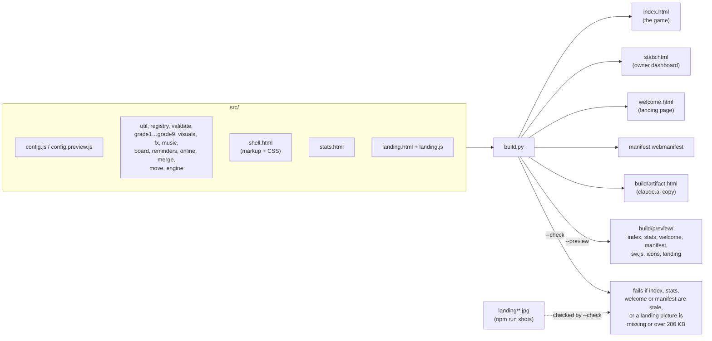
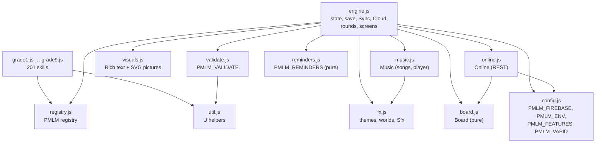
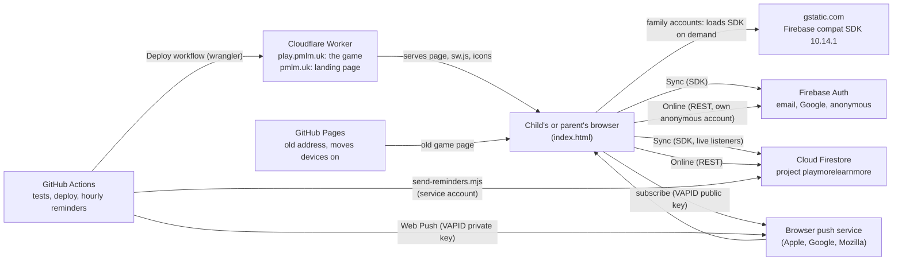
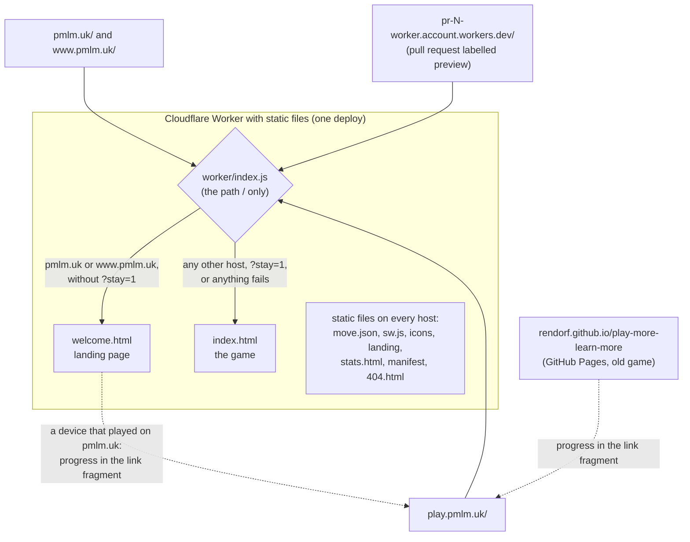

# Architecture

**Who this is for:** the owner, new engineers, and anyone who wants a quick picture of how the game is built.
**Last checked against:** BUILD 2026-10-28 10:20 UTC.

## In plain words

Play More Learn More is one web page. Everything a child needs (lessons, questions, pictures, sounds, progress) is inside that page, so it opens fast, keeps working without internet once open, and runs on old tablets. There is no app store app and no server of our own.

- **Cloudflare** (a Worker with static files) hosts the game at https://play.pmlm.uk/ and a "how it works" landing page at https://pmlm.uk/, for free. The old **GitHub Pages** address still runs, only to send devices on.
- **Progress** is saved in the browser on each device.
- **Google Firebase** (a hosted login and database service) is optional. Families use it to see one child's progress on every device. A friends-and-family test also uses it for anonymous play stats, feedback, the leaderboard, invites and reminders.
- **GitHub Actions** runs every test before a change goes live, publishes it to Cloudflare, and sends daily reminders once an hour.

Running costs are close to zero: static hosting, Firebase's free tier, and free GitHub Actions minutes.

## Build pipeline

The source lives in `src/`. `build.py` inlines every source file into one HTML page per output. `index.html`, `stats.html` and `welcome.html` are generated, so never edit them by hand.

- Scripts are inlined in a fixed order: `config.js`, `util.js`, `registry.js`, `validate.js`, `grade1.js` … `grade9.js`, `visuals.js`, `fx.js`, `music.js`, `board.js`, `reminders.js`, `online.js`, `merge.js`, `move.js`, `engine.js`.
- `welcome.html` is `landing.html` with only `config.js`, `move.js` and `landing.js` inlined, and the game's address (`PMLM_MOVE_TO`) in its Play buttons. Its pictures stay separate files in `landing/`: real game screenshots taken by `cd tests && npm run shots` from a local build with made-up players.
- `__BUILD__` is replaced with the build time (for example `2026-10-25 18:32 UTC`). Parents see it in the Parents area, and each linked device reports it.
- `--preview` builds from `config.preview.js`, adds a red PREVIEW ribbon and names the Home Screen app "PMLM Preview".
- `--check` ignores the build time. The tests and the Deploy workflow run it.
- `build/artifact.html` is the page body only (no `<html>` wrapper). It is not committed and not checked by `--check`.

## Runtime modules

All modules are plain browser scripts that share one global scope. There is no framework and no bundler.

| Module | Job |
|---|---|
| `engine.js` | Saved state and `save()`, rounds and mastery, wishes, parent area, all screens. Holds `Sync` (family accounts) and `Cloud` (claude.ai storage). |
| `online.js` | Family-test extras over Firebase REST with its own anonymous account: stats events, feedback, leaderboard, push subscriptions, invites, Home Screen install. Separate from `Sync`. |
| `analytics.js` | Google Analytics for the landing page and the game, on pmlm.uk and play.pmlm.uk only (`Analytics`): Consent Mode cookieless until a grown-up allows cookies (the `pmlm_analytics` cookie on `.pmlm.uk`), advertising off, game stats events without ids. Google's script loads with the first thing sent. Also inlined into the landing page. |
| `board.js` | Leaderboard nicknames, ISO weeks, active minutes, ranking. Pure, so unit tests load it alone. |
| `reminders.js` | Reminder messages and when to send one. Pure. The hourly sender loads the same file. |
| `grade1.js` … `grade9.js` | Lessons and question generators (format in [`src/CONTRACT.md`](../../src/CONTRACT.md)). |
| `validate.js` | Content checks shared by the checker and the in-game self-test. |
| `sw.js` | Push-only service worker. Shows reminders. Caches nothing. |

## External services

- **Family accounts (`Sync`)** use the Firebase compat SDK (app, auth, firestore), loaded from gstatic only when a family account is used. That gives live listeners and offline write retries.
- **Extras (`Online`)** use the Auth and Firestore REST APIs with `fetch`, and their own anonymous account kept on the device. They never touch the family login.
- **Reminders:** `.github/workflows/reminders.yml` runs at 5 minutes past every hour. It reads `push/*` with a service account and sends Web Push messages. The message carries no address: a tap opens the address the device subscribed from (`sw.js` opens its own scope).

## Hosting and routing

One Cloudflare Worker with static files serves both names (settings in `tools/deploy/wrangler.json`). Static files can't give the same path a different page per host, so the Worker's code (`worker/index.js`) runs for `/` only and picks the page. Every other path is a plain static file on every host, and a mistyped one gets `404.html`.

- **The Deploy workflow** (`.github/workflows/deploy.yml`) publishes the project after the **Tests** workflow passes on `main`. `tools/deploy/stage.sh` copies only the served files, a pinned wrangler deploys them with the Worker (`wrangler deploy`), and `tools/deploy/check-live.sh` checks both hosts afterwards. Details in [operations.md](operations.md#deploy-workflow).
- **`?stay=1`** is the landing page's "Keep playing here" when play.pmlm.uk doesn't answer: pmlm.uk then serves the game as before.
- **GitHub Pages** still publishes the repository root from `main` at the old address. It ignores `worker/`, `tools/deploy/wrangler.json` and `_headers`.

## Deployment targets

| | Live | Preview | Cloudflare preview | claude.ai artifact |
|---|---|---|---|---|
| Built by | `python3 build.py` | `python3 build.py --preview` | `python3 build.py` (the pull request's committed files) | `python3 build.py` (`build/artifact.html`) |
| Published to | https://play.pmlm.uk/ (the game) and https://pmlm.uk/ (the landing page): one Cloudflare Worker, by the Deploy workflow after the tests pass on `main`. The old address https://rendorf.github.io/play-more-learn-more/ (GitHub Pages, from `main`) moves devices to play.pmlm.uk | https://rendorf.github.io/pmlm-preview/ (`tools/deploy-preview.sh`, repo `Rendorf/pmlm-preview`) | a Worker version uploaded but not deployed, at `https://pr-<number>-<worker>.<account>.workers.dev/` when workers.dev is on (`/welcome` is the landing page), by the Deploy workflow for a pull request labelled `preview` | the claude.ai artifact named in `CLAUDE.md`, with the Artifact tool |
| Settings | `src/config.js` | `src/config.preview.js` | `src/config.js` (the live settings) | `src/config.js`, but online parts switch themselves off |
| Firebase | live project `playmorelearnmore` | a separate staging project (currently `null` until set up) | the live project, so open its game only with `#debug` | none: the artifact CSP blocks gstatic |
| Device storage keys | `pmlm.*` | `pmlm-preview.*` | `pmlm.*` in the workers.dev origin | `pmlm.*` in the artifact's own origin |
| Cross-device saving | family accounts | staging family accounts | not for real use | the artifact `db` capability, one document per viewer |
| Marked | no | red PREVIEW ribbon, "PMLM Preview" | no | no |

The preview shares the `rendorf.github.io` origin with the old address, so it must use different storage keys. A browser test checks that the preview never touches real progress.

Browsers keep saved progress per address, so moving the game moves each device's progress with it (`src/move.js`). Two old addresses send devices to play.pmlm.uk:

- **the GitHub address**, where the old game does it at start-up;
- **pmlm.uk**, which served the game until October 2026, where the landing page does it before drawing anything (`Landing.decide()` in `src/landing.js`).

Each first checks that play.pmlm.uk serves the game (`move.json`, readable from any address through `_headers`), then opens play.pmlm.uk with the progress packed into the `#move=` fragment, which never reaches a server. play.pmlm.uk merges it in like a backup code. Sign-ins stay at the old address, so parents log in again and linked devices link again. Home Screen apps on iPhone and iPad keep their own storage, so they move with a progress code: an old pmlm.uk icon shows **Copy progress code** at once, and an old GitHub icon has it under Parents → Move to play.pmlm.uk. See [ADR 0007](decisions/0007-landing-page-and-play-subdomain.md) and [UX flows](../design/ux-flows.md#11-moving-to-playpmlmuk).

## Where to read next

- [data-model.md](data-model.md): what is saved and where.
- [sync-and-accounts.md](sync-and-accounts.md): family accounts step by step.
- [security.md](security.md): who can read and write what.
- [decisions/](decisions/README.md): why it is built this way.
