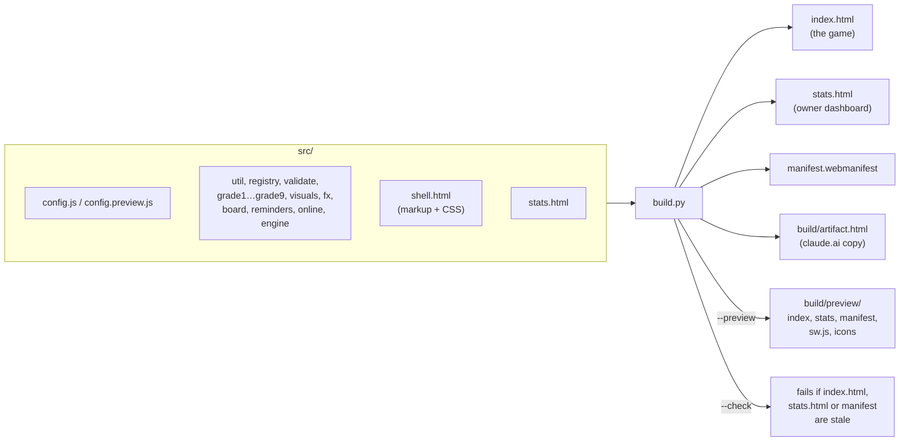
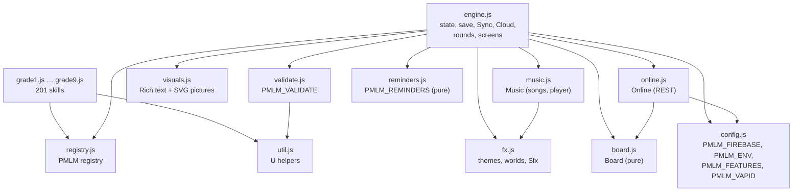
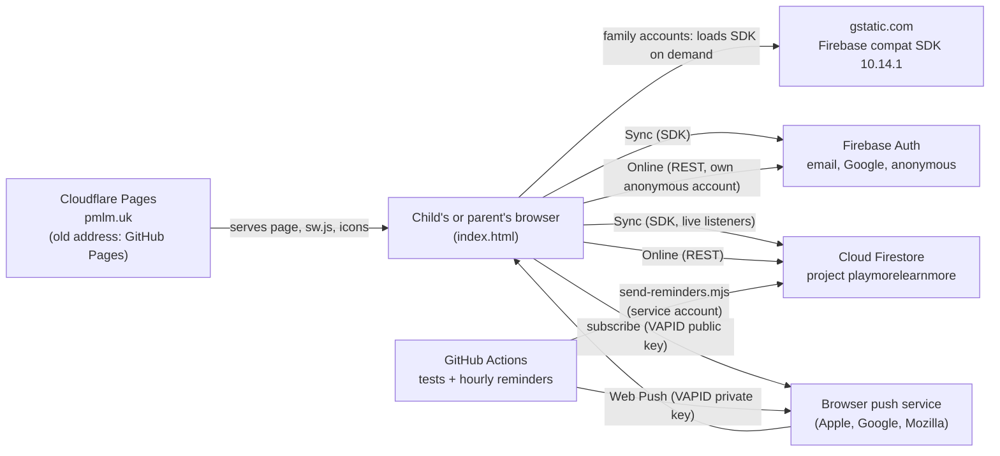

# Architecture

**Who this is for:** the owner, new engineers, and anyone who wants a quick picture of how the game is built.
**Last checked against:** BUILD 2026-10-25 18:32 UTC.

## In plain words

Play More Learn More is one web page. Everything a child needs (lessons, questions, pictures, sounds, progress) is inside that page, so it opens fast, keeps working without internet once open, and runs on old tablets. There is no app store app and no server of our own.

- **GitHub Pages** hosts the page for free.
- **Progress** is saved in the browser on each device.
- **Google Firebase** (a hosted login and database service) is optional. Families use it to see one child's progress on every device. A friends-and-family test also uses it for anonymous play stats, feedback, the leaderboard, invites and reminders.
- **GitHub Actions** runs every test before a change goes live, and sends daily reminders once an hour.

Running costs are close to zero: static hosting, Firebase's free tier, and free GitHub Actions minutes.

## Build pipeline

The source lives in `src/`. `build.py` inlines every source file into one HTML page. `index.html` is generated, so never edit it by hand.

- Scripts are inlined in a fixed order: `config.js`, `util.js`, `registry.js`, `validate.js`, `grade1.js` … `grade9.js`, `visuals.js`, `fx.js`, `music.js`, `board.js`, `reminders.js`, `online.js`, `engine.js`.
- `__BUILD__` is replaced with the build time (for example `2026-10-25 18:32 UTC`). Parents see it in the Parents area, and each linked device reports it.
- `--preview` builds from `config.preview.js`, adds a red PREVIEW ribbon and names the Home Screen app "PMLM Preview".
- `--check` ignores the build time. The tests run it.
- `build/artifact.html` is the page body only (no `<html>` wrapper). It is not committed and not checked by `--check`.

## Runtime modules

All modules are plain browser scripts that share one global scope. There is no framework and no bundler.

| Module | Job |
|---|---|
| `engine.js` | Saved state and `save()`, rounds and mastery, wishes, parent area, all screens. Holds `Sync` (family accounts) and `Cloud` (claude.ai storage). |
| `online.js` | Family-test extras over Firebase REST with its own anonymous account: stats events, feedback, leaderboard, push subscriptions, invites, Home Screen install. Separate from `Sync`. |
| `board.js` | Leaderboard nicknames, ISO weeks, active minutes, ranking. Pure, so unit tests load it alone. |
| `reminders.js` | Reminder messages and when to send one. Pure. The hourly sender loads the same file. |
| `grade1.js` … `grade9.js` | Lessons and question generators (format in [`src/CONTRACT.md`](../../src/CONTRACT.md)). |
| `validate.js` | Content checks shared by the checker and the in-game self-test. |
| `sw.js` | Push-only service worker. Shows reminders. Caches nothing. |

## External services

- **Family accounts (`Sync`)** use the Firebase compat SDK (app, auth, firestore), loaded from gstatic only when a family account is used. That gives live listeners and offline write retries.
- **Extras (`Online`)** use the Auth and Firestore REST APIs with `fetch`, and their own anonymous account kept on the device. They never touch the family login.
- **Reminders:** `.github/workflows/reminders.yml` runs at 5 minutes past every hour. It reads `push/*` with a service account and sends Web Push messages.

## Three deployment targets

| | Live | Preview | claude.ai artifact |
|---|---|---|---|
| Built by | `python3 build.py` | `python3 build.py --preview` | `python3 build.py` (`build/artifact.html`) |
| Published to | https://pmlm.uk/ (Cloudflare Pages, from `main`); the old address https://rendorf.github.io/play-more-learn-more/ (GitHub Pages, from `main`) moves devices there | https://rendorf.github.io/pmlm-preview/ (`tools/deploy-preview.sh`, repo `Rendorf/pmlm-preview`) | the claude.ai artifact named in `CLAUDE.md`, with the Artifact tool |
| Settings | `src/config.js` | `src/config.preview.js` | `src/config.js`, but online parts switch themselves off |
| Firebase | live project `playmorelearnmore` | a separate staging project (currently `null` until set up) | none: the artifact CSP blocks gstatic |
| Device storage keys | `pmlm.*` | `pmlm-preview.*` | `pmlm.*` in the artifact's own origin |
| Cross-device saving | family accounts | staging family accounts | the artifact `db` capability, one document per viewer |
| Marked | no | red PREVIEW ribbon, "PMLM Preview" | no |

The preview shares the `rendorf.github.io` origin with the live game, so it must use different storage keys. A browser test checks that the preview never touches real progress.

Browsers keep saved progress per address, so moving the game from rendorf.github.io to pmlm.uk moves each device's progress with it: the old address checks that pmlm.uk serves the game (`move.json`), then opens pmlm.uk with the progress packed into the `#move=` fragment, which never reaches a server. pmlm.uk merges it in like a backup code. Home Screen apps on iPhone and iPad keep their own storage, so they move with a code (Parents → Move to pmlm.uk). See `src/move.js`.

## Where to read next

- [data-model.md](data-model.md): what is saved and where.
- [sync-and-accounts.md](sync-and-accounts.md): family accounts step by step.
- [security.md](security.md): who can read and write what.
- [decisions/](decisions/README.md): why it is built this way.
