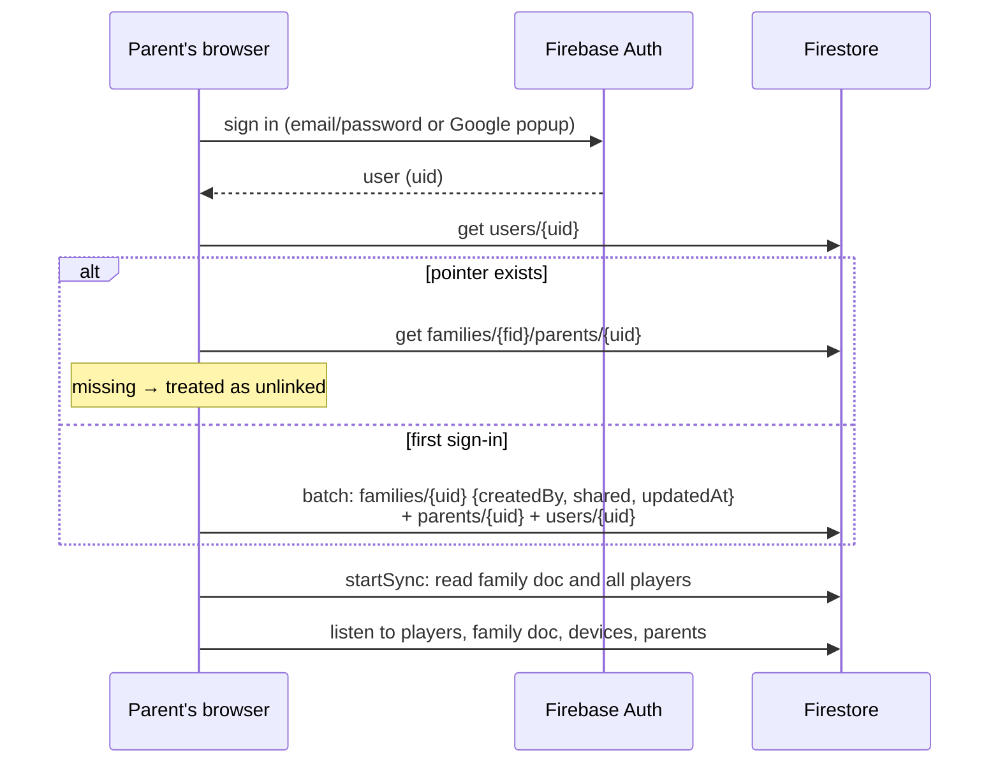
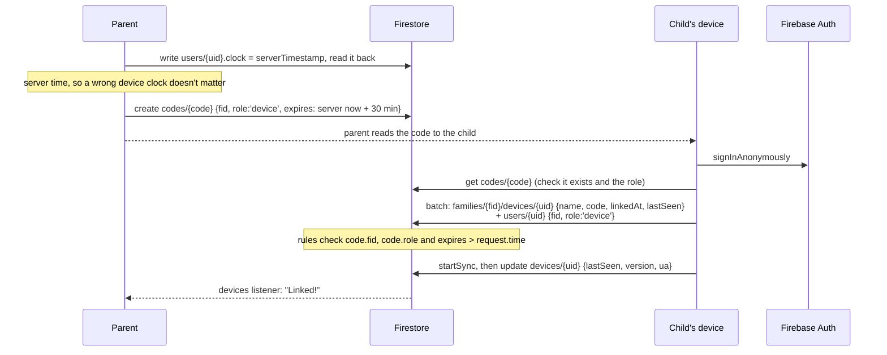
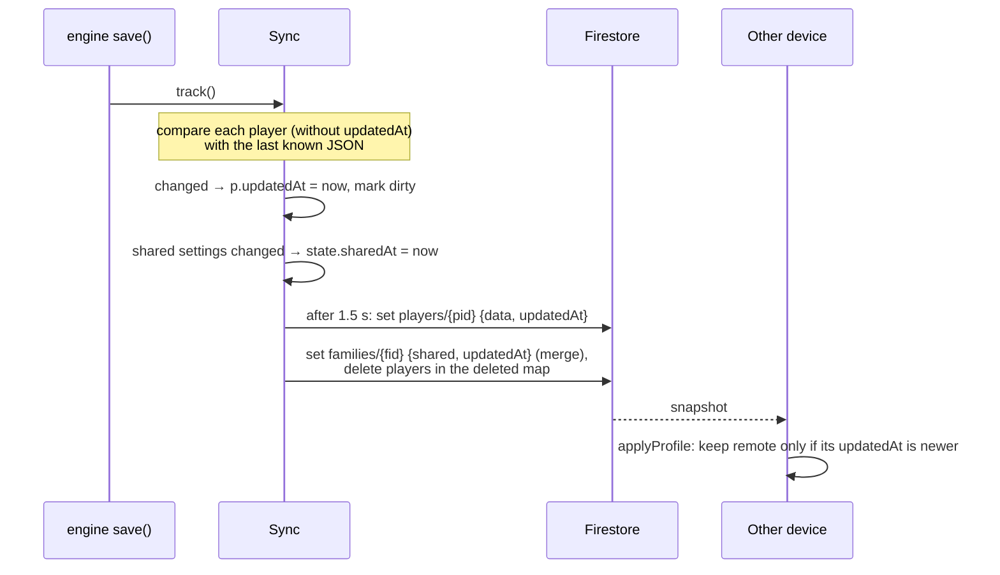
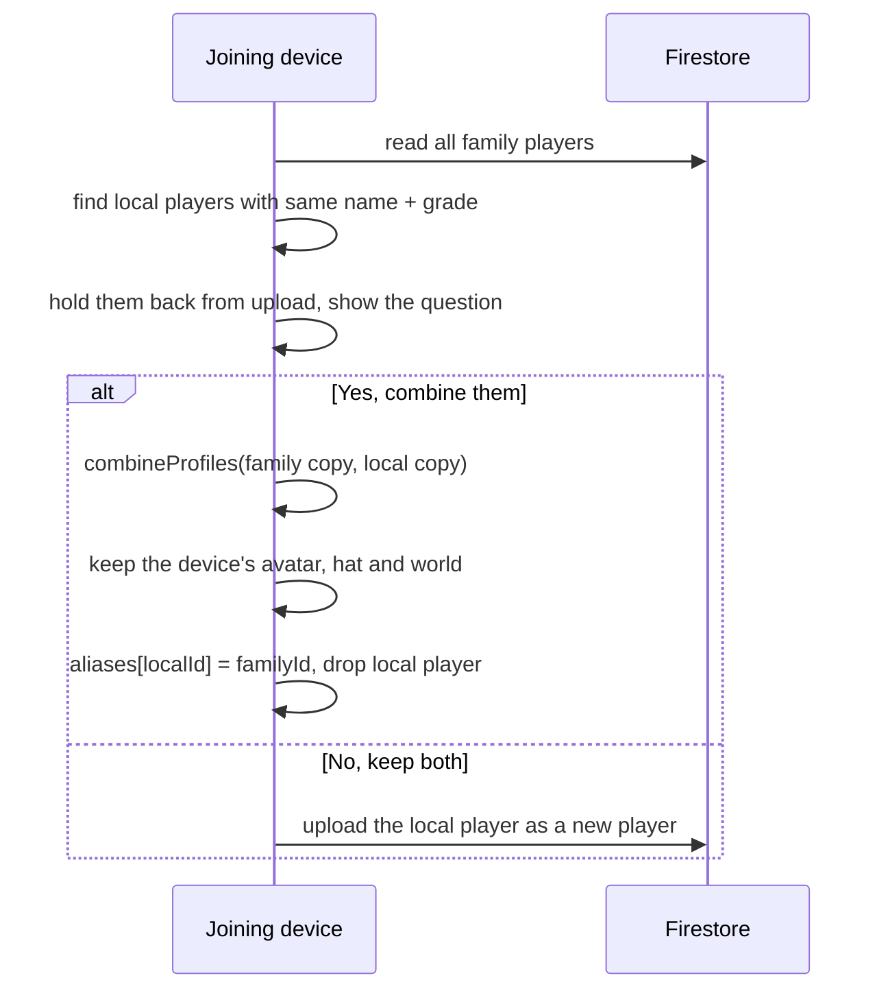

# Family accounts and sync

**Who this is for:** engineers working on `Sync` in `src/engine.js`, and the owner when a family reports lost or doubled progress.
**Last checked against:** BUILD 2026-10-25 18:32 UTC.

Family accounts are optional. Without them, progress stays in each browser and backup codes move it between devices. With them, every player is kept in Firestore and every linked device sees the same progress.

`Sync` uses the Firebase compat SDK (app, auth, firestore), loaded from gstatic only when needed. It is separate from `Online` (the family-test extras), which has its own anonymous account. See [data-model.md](data-model.md) for the document shapes.

## Roles

- **Parent:** signs in with email and password or Google. The first sign-in creates `families/{uid}`, so the family id is the first parent's uid.
- **Second parent:** signs in, then types a parent invite code (valid 24 hours).
- **Child's device:** signs in anonymously and joins with a device link code (valid 30 minutes). Children never see a parent password.

`users/{uid}` points each account at its family (`fid`, `role`). It is only a pointer: access comes from `families/{fid}/parents/{uid}` or `families/{fid}/devices/{uid}`.

## Parent sign-in

## Linking a child's device

Codes are 8 characters from an alphabet without look-alikes (no I, L, O, 0, 1), shown as `ABCD-EFGH`.

- Expiry is set from the server's clock and checked by the rules against `request.time`. The rules accept any expiry under 2 days; the 30-minute and 24-hour limits come from the client.
- A parent invite works the same way with `role: 'parent'` and 24 hours. A refused invite signs the parent out again, so a reload can't create a stray family.
- A parent can cancel a code (delete it), unlink a device or remove another parent. A device can unlink itself.

## Per-player documents, newest wins

Each player is `families/{fid}/players/{pid}` with `data` (the player as JSON) and `updatedAt`. Two children playing at once on different devices write different documents, so they never overwrite each other.

- `Sync.track()` runs at the start of every `save()`. It only stamps players whose content really changed. This is why reading a player must never write defaults into it (see lazy defaults in [data-model.md](data-model.md)).
- If an update for the active player arrives during a round, it waits. When the round ends, `Sync.settle()` stamps the round first, so this device's round wins.
- Remote snapshots with pending local writes are ignored.

## The shared family document

`families/{fid}.shared` is a JSON string with the parent PIN, money symbol, timer setting, daily goal, team goal, player order and a `deleted` map. It has its own `updatedAt`, compared with `state.sharedAt`.

- Newer shared settings replace this device's.
- When a device joins, the family's PIN and settings win, even if older.
- `deleted` is merged from both sides, and listed players are removed everywhere. Which player is active stays per device.
- If the shared settings were written by a version too old to know `goal` or `team`, this device writes its own back on the next save.

## Joining with a child already on the device

If a player on the joining device has the same name (ignoring case) and grade as a family player, the device holds that player back and asks: **"Is this the same …?"**

## Combining players and aliases

`combineProfiles(a, b, sum)` merges `b` into `a`:

- Coins, points and counters are added (when combining two players) or the larger is kept (when importing a backup code of the same player).
- For each skill the better record wins (mastered, then stars, then tries). Fix-it queues are merged without duplicates.
- Trophies keep the earliest date. Streak, pet, chest, stickers, pages, daily log, week totals, streak wishes, invite friends and rewards are merged.

Parents can also combine two players by hand (Parents → Players → "Same child twice?").

`state.aliases` maps each removed id to the kept id. A backup code made later on another device still carries the old id, so the import updates the kept player instead of bringing the old one back.

## Offline

- Play never waits for the network. Changes are saved on the device first and stay dirty until a write succeeds.
- The status line shows "Offline. Changes will upload when the internet is back." Failed writes retry after 15 seconds and when the browser goes back online.
- The Firestore SDK also queues writes while offline.
- A `permission-denied` answer means the device was unlinked. It stops syncing, clears its pointer and keeps its players locally.

## Testing these flows

Never test against the live family data. Use the mock backend (`python3 tools/make-synctest.py`, then open `build/synctest.html`) or the emulators. See [testing.md](testing.md).
